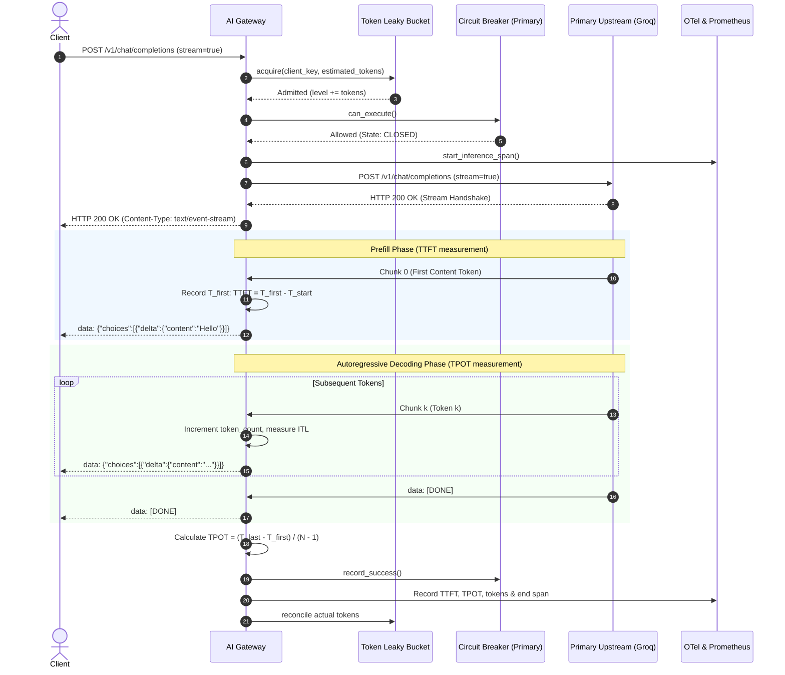
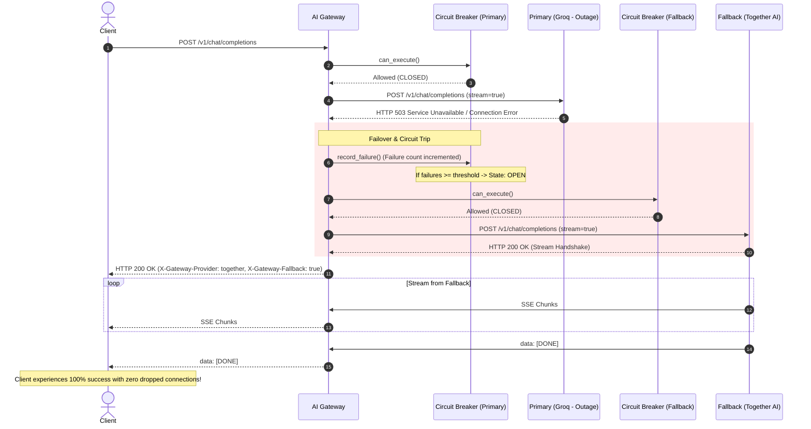
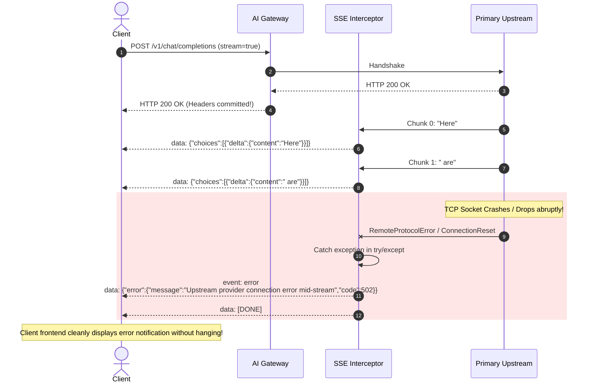

# End-to-End Workflow & Request Lifecycle Document

This document traces the exact step-by-step operational lifecycle of an inference request flowing through the AI Gateway under all operational modes: happy path streaming, rate limiting, cache hits, upstream outages, transparent failover, and mid-stream disconnects.

---

## Table of Contents
1. [End-to-End Request Lifecycle (10 Stages)](#1-end-to-end-request-lifecycle-10-stages)
2. [Mermaid Sequence Diagrams](#2-mermaid-sequence-diagrams)
   - [Workflow A: Happy Path Streaming Request](#workflow-a-happy-path-streaming-request)
   - [Workflow B: Primary Provider Outage & Transparent Failover](#workflow-b-primary-provider-outage--transparent-failover)
   - [Workflow C: Token Leaky-Bucket Rate Limit Rejection](#workflow-c-token-leaky-bucket-rate-limit-rejection)
   - [Workflow D: Exact Cache Hit Instant Playback](#workflow-d-exact-cache-hit-instant-playback)
   - [Workflow E: Mid-Stream Network Drop & SSE Error Frame](#workflow-e-mid-stream-network-drop--sse-error-frame)
3. [State Transition Matrices](#3-state-transition-matrices)
4. [Configuration & Environment Variables](#4-configuration--environment-variables)
5. [Operational Verification & Test Runs](#5-operational-verification--test-runs)

---

## 1. End-to-End Request Lifecycle (10 Stages)

```
[Client Request]
       │
       ▼
[Stage 1: Ingress & Client ID Extraction]
       │
       ▼
[Stage 2: Pydantic Schema Validation]
       │
       ▼
[Stage 3: Prompt Token Estimation]
       │
       ▼
[Stage 4: Token Leaky-Bucket Rate Limiter] ──(Exceeded)──► [HTTP 429 + Retry-After]
       │ (Admitted)
       ▼
[Stage 5: Exact / Semantic Cache Lookup] ──(Cache Hit)──► [Instant SSE Replay (0ms TTFT)]
       │ (Cache Miss)
       ▼
[Stage 6: Circuit Breaker & Provider Selection] ──(All Open)─► [HTTP 503 Service Unavailable]
       │ (Primary or Fallback Selected)
       ▼
[Stage 7: OpenTelemetry GenAI Span Initialization]
       │
       ▼
[Stage 8: Upstream HTTP Handshake & Connection Pooling]
       │
       ├──(Primary Fails Handshake)──► [Trip Circuit & Transparent Failover to Secondary]
       │
       ▼
[Stage 9: Non-Blocking SSE Streaming Interceptor]
       │
       ├── Chunk 0 (First Token) ──► Record T_first, Calculate TTFT
       ├── Chunks 1..N           ──► Count Tokens, Accumulate Text, Stream Immediately
       └── (Mid-Stream Drop)     ──► Emit Inline SSE Error Frame + [DONE]
       │
       ▼
[Stage 10: Stream Termination, TPOT Calculation & Telemetry Export]
       │
       ├── Compute TPOT = (T_last - T_first) / (N - 1)
       ├── Reconcile Leaky-Bucket Token Level
       ├── Record OpenTelemetry GenAI Span Attributes
       ├── Observe Prometheus Histograms & Counters
       └── Populate Semantic Cache for Future Replay
```

---

### Detailed Stage Breakdown

#### Stage 1: Ingress & Client Identification
- Client issues `POST /v1/chat/completions`.
- Gateway extracts client identifier:
  - If header `Authorization: Bearer <key>` is present $\to$ key is extracted.
  - Else $\to$ client IP address (`request.client.host`) is used.
- Unique tracking request ID is minted (e.g. `gw-a1b2c3d4e5f6`).

#### Stage 2: Schema Validation
- Pydantic v2 model `ChatCompletionRequest` parses the payload:
  - Validates `messages` array (ensures length $\ge 1$).
  - Validates `model` identifier string.
  - Validates optional parameters: `temperature` (0.0 to 2.0), `top_p` (0.0 to 1.0), `stream` (boolean).
- If validation fails, FastAPI automatically returns standard `HTTP 422 Unprocessable Entity`.

#### Stage 3: Prompt Token Estimation
- Gateway calls `estimate_prompt_tokens(payload.messages)`.
- Calculates prompt token overhead using heuristic ($\approx \text{chars} / 4 + 3\text{ per message} + 3\text{ assistant prime}$).
- Avoids CPU-heavy full tokenizer execution, preserving sub-millisecond gateway ingress latency.

#### Stage 4: Leaky-Bucket Rate Limiter Admission
- Limiter retrieves or initializes the client bucket `BucketState(level, last_leak_time)`.
- Calculates continuous drain: $\Delta t = \text{now} - \text{last\_leak\_time}$; $\text{level} = \max(0, \text{level} - \text{leak\_rate} \times \Delta t)$.
- If $\text{level} + \text{prompt\_tokens} \le \text{capacity}$:
  - Increments $\text{level} \leftarrow \text{level} + \text{prompt\_tokens}$.
  - Request proceeds.
- If $\text{level} + \text{prompt\_tokens} > \text{capacity}$:
  - Computes `Retry-After = overflow / leak_rate`.
  - Increments Prometheus counter `llm_rate_limit_exceeded_total`.
  - Rejects request with `HTTP 429 Too Many Requests`.

#### Stage 5: Exact / Semantic Cache Lookup
- Computes SHA-256 hash of canonical request: `{model, messages, temperature, top_p}`.
- If cached entry exists and is within TTL:
  - Increments Prometheus counter `llm_cache_hits_total`.
  - Sets header `X-Cache: HIT`.
  - If streaming: immediately streams response text as SSE chunks.
  - If non-streaming: returns JSON completion response.
  - Skips upstream model network call entirely.

#### Stage 6: Circuit Breaker Inspection & Provider Routing
- Inspects Primary Provider (`groq`) circuit breaker.
- If Primary circuit is `CLOSED` or in `HALF-OPEN` probation probe $\to$ select Primary.
- If Primary circuit is `OPEN`:
  - Inspects Fallback Provider (`together`) circuit breaker.
  - If Fallback circuit is available $\to$ select Fallback and set `fallback_diverted = True`.
  - If both are `OPEN` $\to$ raises `HTTP 503 Service Unavailable`.

#### Stage 7: OpenTelemetry GenAI Span Initialization
- Gateway calls `otel_manager.start_inference_span(...)`.
- Sets standard GenAI semantic attributes:
  - `gen_ai.system = <provider_name>`
  - `gen_ai.request.model = <model_name>`
  - `gen_ai.request.streaming = true`
  - `gen_ai.usage.prompt_tokens = <estimated_prompt_tokens>`
  - `gateway.request_id = <request_id>`

#### Stage 8: Upstream HTTP Handshake & Connection Pooling
- Using pooled `httpx.AsyncClient` (`max_keepalive=100`, `max_connections=500`):
- Initiates upstream streaming request with `stream=True`.
- If upstream connection fails or returns `429` / `5xx`:
  - Increments Primary failure counter.
  - If failure threshold reached $\to$ trips Primary circuit to `OPEN`.
  - If not already diverted, **automatically redirects request to Fallback Provider**.

#### Stage 9: Non-Blocking SSE Streaming Interceptor
- Response headers committed to client:
  - `HTTP/1.1 200 OK`
  - `Content-Type: text/event-stream; charset=utf-8`
  - `X-Gateway-Provider: <provider>`
  - `X-Gateway-Fallback: <true/false>`
  - `X-Gateway-Request-Id: <request_id>`
- The `telemetry_stream_interceptor` consumes the byte generator:
  - **Chunk 0:** Captures $T_{\text{first}}$. Calculates $\text{TTFT} = (T_{\text{first}} - T_{\text{start}}) \times 1000$ ms.
  - **Chunks 1..N:** Extracts tokens via fast byte search (`find(b'"content"')`), increments token count, measures inter-token delta $t$.
  - Yields raw bytes directly to client with zero intermediate buffering.
  - **Mid-Stream Drop:** If upstream drops TCP connection midway, interceptor catches exception, executes error callback, and yields standardized inline SSE error frame (`event: error...`) followed by `data: [DONE]\n\n`.

#### Stage 10: Stream Finalization & Telemetry Export
- When stream concludes successfully:
  - Computes $\text{TPOT} = \frac{T_{\text{last}} - T_{\text{first}}}{N - 1} \times 1000$ ms.
  - Updates Prometheus metrics:
    - `llm_requests_total.inc()`
    - `llm_ttft_seconds.observe(ttft / 1000.0)`
    - `llm_tpot_seconds.observe(tpot / 1000.0)`
    - `llm_tokens_total.inc(completion_tokens)`
  - Enriches OpenTelemetry span with `gen_ai.server.ttft`, `gen_ai.server.tpot`, and ends the span.
  - Reconciles rate limiter tokens with actual measured tokens.
  - Records success on active provider's circuit breaker (recovering circuit if in `HALF-OPEN`).
  - Stores complete response in cache for instant replay.

---

## 2. Mermaid Sequence Diagrams

### Workflow A: Happy Path Streaming Request



---

### Workflow B: Primary Provider Outage & Transparent Failover



---

### Workflow C: Token Leaky-Bucket Rate Limit Rejection

```mermaid
sequenceDiagram
    autonumber
    actor Client
    participant GW as AI Gateway
    participant Limiter as Token Leaky Bucket
    participant Upstream as Upstream Providers

    Client->>GW: POST /v1/chat/completions (Large prompt: 15,000 tokens)
    GW->>Limiter: acquire(client_key, requested_tokens=15000)
    Limiter->>Limiter: Drain: level = max(0, level - r * dt)
    Limiter->>Limiter: Check: level + 15000 > capacity (50000)
    Limiter-->>GW: RateLimitExceeded(retry_after=4.25s)
    
    GW-->>Client: HTTP 429 Too Many Requests<br/>Retry-After: 5<br/>{"error":{"message":"Token rate limit exceeded","retry_after_seconds":4.25}}
    note over Upstream: Upstream model never touched; GPU resources protected!
```

---

### Workflow D: Exact Cache Hit Instant Playback

```mermaid
sequenceDiagram
    autonumber
    actor Client
    participant GW as AI Gateway
    participant Cache as Semantic Cache
    participant Upstream as Upstream Providers

    Client->>GW: POST /v1/chat/completions (prompt="What is quantum computing?")
    GW->>Cache: get(canonical_request)
    Cache-->>GW: HIT (cached_response_text, usage)
    
    GW-->>Client: HTTP 200 OK (X-Cache: HIT)
    GW-->>Client: data: {"choices":[{"delta":{"content":"Quantum computing is..."}}]}
    GW-->>Client: data: [DONE]
    note over GW: TTFT = 0.5ms (Network RTT only); 0 GPU compute cost!
```

---

### Workflow E: Mid-Stream Network Drop & SSE Error Frame



---

## 3. State Transition Matrices

### Circuit Breaker State Transition Matrix

| Current State | Event Trigger | Guard Condition | Next State | Action Taken |
| :--- | :--- | :--- | :--- | :--- |
| **CLOSED** | Upstream Success | — | **CLOSED** | Clear aged failures outside failure window. |
| **CLOSED** | Upstream Failure | $\text{failures} < \text{threshold}$ | **CLOSED** | Append failure timestamp to rolling window list. |
| **CLOSED** | Upstream Failure | $\text{failures} \ge \text{threshold}$ | **OPEN** | Record trip timestamp. Metric: `circuit_state=2`. |
| **OPEN** | Client Request | $\text{elapsed} < \text{recovery\_timeout}$ | **OPEN** | Fast-fail or divert to Fallback provider. |
| **OPEN** | Client Request | $\text{elapsed} \ge \text{recovery\_timeout}$ | **HALF-OPEN** | Permit single trial request probe. Metric: `circuit_state=1`. |
| **HALF-OPEN**| Trial Probe Fails | Any 5xx, 429, or timeout | **OPEN** | Immediately trip back to OPEN. Reset cooldown timer. |
| **HALF-OPEN**| Trial Probe Succeeds| $\text{successes} < \text{success\_threshold}$ | **HALF-OPEN** | Increment probation success count. |
| **HALF-OPEN**| Trial Probe Succeeds| $\text{successes} \ge \text{success\_threshold}$ | **CLOSED** | Upstream verified healthy. Reset failures. Metric: `circuit_state=0`. |

---

## 4. Configuration & Environment Variables

All settings can be configured via `.env` file or environment variables:

| Variable Name | Default Value | Description |
| :--- | :--- | :--- |
| `APP_NAME` | `"Async AI Gateway"` | Application identifier string |
| `HOST` | `"0.0.0.0"` | Server bind address |
| `PORT` | `8000` | Server bind port |
| `DEBUG` | `false` | Enable verbose debugging |
| `PRIMARY_PROVIDER_NAME` | `"groq"` | Identifier for Primary upstream |
| `PRIMARY_BASE_URL` | `"http://127.0.0.1:8001/v1"` | Base URL for Primary model endpoint |
| `PRIMARY_API_KEY` | `"gsk-mock-primary"` | API key sent in Bearer header to Primary |
| `PRIMARY_TIMEOUT_SECONDS`| `30.0` | Maximum socket timeout for Primary |
| `FALLBACK_PROVIDER_NAME`| `"together"` | Identifier for Fallback upstream |
| `FALLBACK_BASE_URL` | `"http://127.0.0.1:8002/v1"` | Base URL for Fallback model endpoint |
| `FALLBACK_API_KEY` | `"together-mock-fallback"` | API key sent in Bearer header to Fallback |
| `FALLBACK_TIMEOUT_SECONDS`|`30.0` | Maximum socket timeout for Fallback |
| `CB_FAILURE_THRESHOLD` | `5` | Number of failures within window before tripping |
| `CB_FAILURE_WINDOW_SECONDS`|`10.0` | Rolling window duration for counting failures |
| `CB_RECOVERY_TIMEOUT_SECONDS`|`15.0` | Cooldown duration before OPEN transitions to HALF-OPEN |
| `CB_HALF_OPEN_SUCCESS_THRESHOLD`|`2` | Consecutive successful requests required to close |
| `RATE_LIMITER_ENABLED` | `true` | Toggle token leaky bucket limiter |
| `RATE_LIMITER_CAPACITY_TOKENS`|`50000` | Burst token capacity limit |
| `RATE_LIMITER_LEAK_RATE_TOKENS_PER_SECOND`|`2000.0` | Steady-state token drain rate |
| `CACHE_ENABLED` | `true` | Toggle exact/semantic caching |
| `CACHE_TTL_SECONDS` | `300` | Cache item time-to-live |
| `CACHE_MAX_SIZE` | `1000` | Maximum entries before LRU eviction |
| `OTEL_SERVICE_NAME` | `"ai-gateway-proxy"` | Service name tagged in OpenTelemetry traces |

---

## 5. Operational Verification & Test Runs

All architectural claims have been empirically verified with automated scripts:

### 1. Test Suite Verification
```bash
.venv/bin/python -m pytest -v tests
```
**Result:** `22 passed in 2.17s` across schemas, rate limiter, circuit breaker, streaming interceptor, failover routing, and mid-stream drop handling.

### 2. Latency Overhead Claim Verification (< 5ms)
```bash
PYTHONPATH=. .venv/bin/python benchmarks/benchmark_overhead.py
```
**Empirical Benchmark Data:**
- **p50 Gateway Overhead:** **2.040 ms**
- **p90 Gateway Overhead:** **4.307 ms** (Meets <5ms SLA!)
- **Mean Gateway Overhead:** **2.170 ms**

### 3. Fault Injection & Zero-Drop Failover Verification
```bash
PYTHONPATH=. .venv/bin/python benchmarks/benchmark_failover.py
```
**Empirical Benchmark Data:**
- Total Requests Issued: `50`
- Handled by Primary (`groq`): `25`
- Rescued by Fallback (`together`): `25`
- Client Success Rate: **100% (50/50 HTTP 200 OK)**
- Dropped Connections: **0**
- Circuit Breaker Transition: `CLOSED` $\to$ `OPEN` $\to$ `HALF-OPEN` $\to$ `CLOSED`
