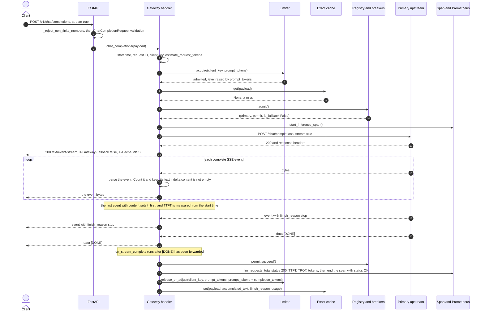
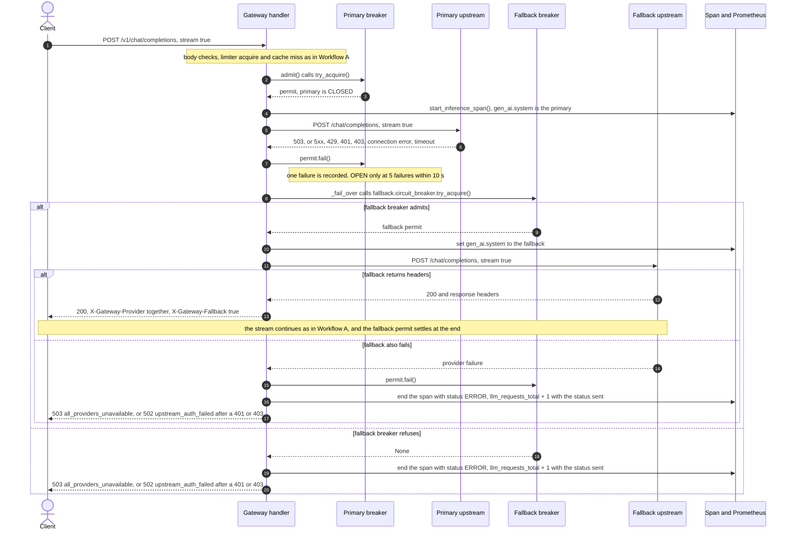
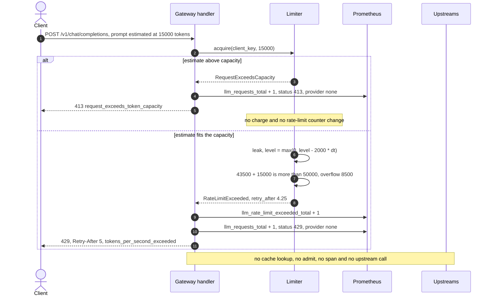
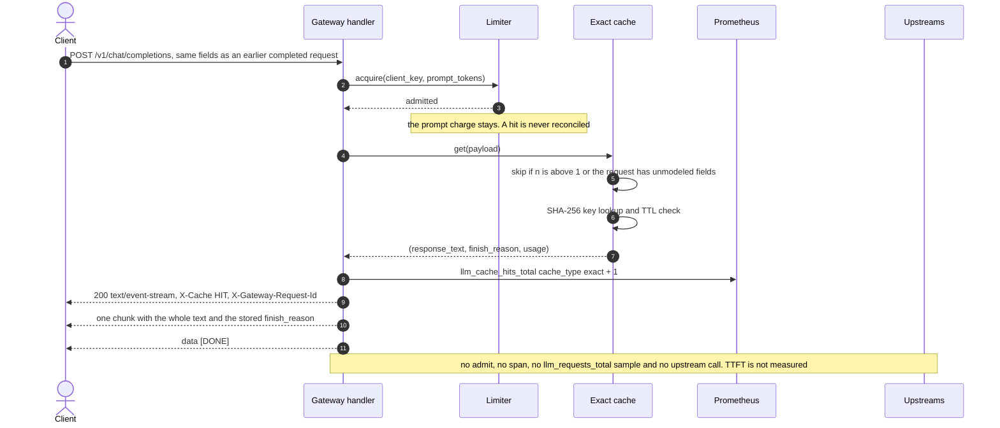
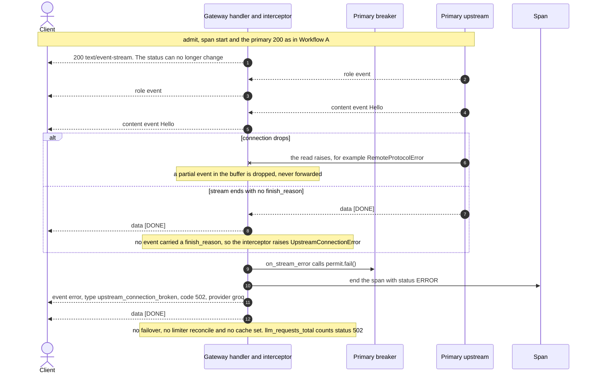
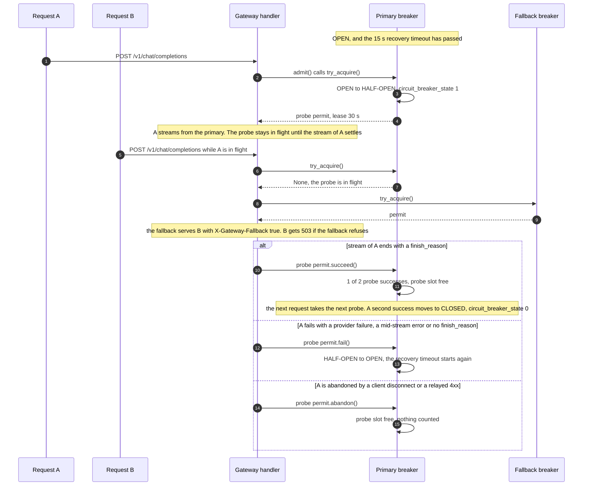

# Request workflow and lifecycle

This document traces a request to `POST /v1/chat/completions` through the gateway, in the order the code in `gateway/main.py` runs it. It covers the streaming paths in detail: the happy path, failover, rate limiting, cache hits, mid-stream failures, and the HALF-OPEN probe. A short section lists where non-streaming requests differ.

---

## Table of contents
1. [Request lifecycle](#1-request-lifecycle)
2. [Sequence diagrams](#2-sequence-diagrams)
   - [Workflow A: happy path streaming request](#workflow-a-happy-path-streaming-request)
   - [Workflow B: primary failure before the first byte and failover](#workflow-b-primary-failure-before-the-first-byte-and-failover)
   - [Workflow C: rate limit rejection](#workflow-c-rate-limit-rejection)
   - [Workflow D: exact cache hit](#workflow-d-exact-cache-hit)
   - [Workflow E: mid-stream failure and the SSE error event](#workflow-e-mid-stream-failure-and-the-sse-error-event)
   - [Workflow F: the single HALF-OPEN probe](#workflow-f-the-single-half-open-probe)
3. [Circuit breaker state transitions](#3-circuit-breaker-state-transitions)
4. [Configuration and environment variables](#4-configuration-and-environment-variables)
5. [Verification and benchmarks](#5-verification-and-benchmarks)

---

## 1. Request lifecycle

```
Client: POST /v1/chat/completions
  |
  v
[1] Body checks, run by FastAPI before the handler
  |   NaN or Infinity in the body ------------------> 400 invalid_request_error
  |   malformed JSON or a schema error -------------> 422 with FastAPI's {"detail": [...]} body
  v
[2] Handler entry: start time, request ID, client key
  v
[3] estimate_request_tokens(payload)
  v
[4] Limiter acquire
  |   estimate above the bucket capacity -----------> 413 request_exceeds_token_capacity
  |   bucket would overflow ------------------------> 429 tokens_per_second_exceeded, Retry-After
  v
[5] Exact cache get
  |   hit ------------------------------------------> 200, one SSE chunk and [DONE], X-Cache: HIT
  v   miss (X-Cache: MISS while the cache is enabled)
[6] registry.admit() returns (provider, permit, is_fallback)
  |   both breakers refuse -------------------------> 503 all_providers_unavailable
  v
[7] start_inference_span()
  v
[8] Upstream request, up to the response headers
  |   4xx other than 401, 403, 429 -----------------> upstream status and body relayed, permit abandoned
  |   provider failure on the primary --------------> permit.fail(), then _fail_over() to the fallback
  |       fallback refused or failed ---------------> 503, or 502 upstream_auth_failed
  |   provider failure on a fallback that admit chose -> 502 upstream_error, or 502 upstream_auth_failed
  v
[9] 200 text/event-stream. Forward each complete SSE event
  |   upstream error, or no finish_reason ----------> event: error, then data: [DONE], permit.fail()
  |   client disconnects ---------------------------> llm_requests_total status 499, permit abandoned
  v
[10] Stream ended with a finish_reason, and [DONE] has been forwarded
     permit.succeed(), Prometheus metrics, span end, limiter reconcile, cache set
```

A provider failure is any of these, raised before the upstream's response headers arrive: a connection error, a timeout, HTTP 429, HTTP 5xx, HTTP 401 or 403 (`PROVIDER_FAILURES` in `gateway/main.py`). Failover happens only on a provider failure before the first byte. Once the gateway has sent the 200 headers, it cannot change the status, so later failures become an SSE error event.

### Responses the gateway returns

All error bodies except the 422 use the OpenAI shape, with `error` at the top level: `{"error": {"message": "...", "type": "..."}}`. No error response carries `X-Gateway-Request-Id`.

| Status | `error.type` | When |
| :--- | :--- | :--- |
| 400 | `invalid_request_error` | The body contains `NaN`, `Infinity`, or a number such as `1e999` that overflows to infinity. |
| 413 | `request_exceeds_token_capacity` | The token estimate is above `RATE_LIMITER_CAPACITY_TOKENS`, so waiting can never help. |
| 422 | none (FastAPI body `{"detail": [...]}`) | The body is malformed JSON or fails `ChatCompletionRequest` validation. |
| 429 | `tokens_per_second_exceeded` | The client's bucket would overflow. The body has `retry_after_seconds`. The `Retry-After` header is `int(retry_after) + 1`. |
| 4xx | the upstream's own body | The upstream returned a 4xx other than 401, 403, or 429. The gateway relays the status and body, as JSON if the body parses and as plain text otherwise. |
| 502 | `upstream_auth_failed` | No provider could serve the request, and the last failure was a 401 or 403. The gateway drops the provider's body, because it called the provider with its own key. |
| 502 | `upstream_error` | `admit()` chose the fallback directly, because the primary breaker refused, and that fallback call failed. There is no retry. |
| 503 | `all_providers_unavailable` | Both breakers refused at `admit()`. Or the primary failed and the fallback breaker refused, or the fallback call failed too. |

---

### Stage details

#### Stage 1: body checks before the handler
- The routes are `POST /v1/chat/completions` and `POST /chat/completions`.
- The dependency `_reject_non_finite_numbers` runs first. It parses the body and calls `json.dumps(body, allow_nan=False)`. If that fails, the gateway returns 400 `invalid_request_error`. This check runs before schema validation, so a body with `NaN` gets 400 even when it also has schema errors.
- FastAPI then validates the body against `ChatCompletionRequest` (`gateway/schemas/openai.py`). `messages` needs at least one item. `temperature` is 0 to 2, `top_p` is 0 to 1, `n` and `max_tokens` are at least 1, and `presence_penalty` and `frequency_penalty` are -2 to 2. Fields the schema does not model, such as `tools`, pass validation and go to the upstream unchanged.
- A malformed body or a schema error gets 422 with FastAPI's `{"detail": [...]}` body, not the OpenAI error shape.

#### Stage 2: handler entry
- The handler records the start time with `time.perf_counter()`. TTFT and total latency are measured from here, after validation.
- It mints a request ID of the form `gw-` plus 12 hex characters, such as `gw-a1b2c3d4e5f6`.
- It takes the client key from `Authorization: Bearer <key>`. Without a Bearer header, the key is `request.client.host`, or `unknown_client` if there is no client address. The key only names the rate-limit bucket. Upstream calls carry the gateway's provider key, not the client's.

#### Stage 3: prompt token estimate
- `estimate_request_tokens(payload)` in `gateway/limiter/tokenizer_estimator.py` estimates the prompt without a tokenizer.
- For each message it adds 3 tokens of framing, `ceil(len / 4)` for the role and for the content, and `ceil(len / 4) + 1` for a `name`. It adds 3 tokens at the end to prime the reply.
- Fields the schema does not model, on the request or on a message, count as their JSON length divided by 4, because they reach the upstream too.

#### Stage 4: leaky-bucket limiter
- This stage runs only when `RATE_LIMITER_ENABLED` is true.
- If the estimate is above the capacity, `acquire` raises `RequestExceedsCapacity` and the client gets 413. The bucket is not charged and `llm_rate_limit_exceeded_total` does not change.
- Otherwise the limiter loads or creates the bucket `BucketState(level, last_leak_time)` and drains it: `level = max(0, level - leak_rate * (now - last_leak_time))`.
- If `level + tokens <= capacity`, the level rises by `tokens` and the request goes on.
- If not, `retry_after = max(0.01, overflow / leak_rate)`, where `overflow = level + tokens - capacity`. The gateway increments `llm_rate_limit_exceeded_total` and returns 429.
- The gateway adjusts the charge only after a stream that completes, a client disconnect (stage 10), or a non-streaming success (see Non-streaming requests). A cache hit, a relayed 4xx, a 502, a 503, or a mid-stream failure keeps the full prompt charge.

#### Stage 5: exact cache lookup
- The cache is exact-match only. There is no semantic matching.
- The key is the SHA-256 of `payload.model_dump()` without `stream` and `user`, serialized with sorted keys. String message content is stripped of surrounding whitespace first. Any other change, such as a different `temperature` or `max_tokens`, is a different key.
- The cache skips both `get` and `set` when the request has `n` above 1 or has fields the schema does not model.
- An entry expires `CACHE_TTL_SECONDS` after it was stored. `get` deletes an expired entry and returns a miss.
- On a hit, the gateway increments `llm_cache_hits_total{cache_type="exact"}` and returns without calling an upstream.
  - A streaming hit sends one SSE chunk that holds the whole stored text with the stored `finish_reason`, then `data: [DONE]`.
  - A non-streaming hit returns a `chat.completion` JSON body with the stored text, the stored `usage`, and the stored `finish_reason`.
  - The hit response has only `X-Cache: HIT` and `X-Gateway-Request-Id`. It has no provider headers, no span, and no `llm_requests_total` sample. The gateway does not measure TTFT on a hit.
- On a miss, every later 200 carries `X-Cache: MISS` while the cache is enabled.

#### Stage 6: provider admission
- `ctx.registry.admit()` in `gateway/circuit_breaker/provider_registry.py` returns `(provider, permit, is_fallback)`.
- It calls `try_acquire()` on the primary breaker first. The primary admits when it is CLOSED, or when it is HALF-OPEN and the probe slot is free. Then `is_fallback` is false.
- If the primary refuses, `admit()` calls `try_acquire()` on the fallback breaker. If the fallback admits, `is_fallback` is true and the primary is not called.
- If both refuse, the client gets 503 `all_providers_unavailable`. A fallback that is HALF-OPEN with its probe in flight also refuses.
- The handler settles the permit once, with `succeed()`, `fail()`, or `abandon()`. Later calls do nothing.

#### Stage 7: OpenTelemetry span
- `ctx.otel.start_inference_span(...)` starts a span named `chat <model>` of kind SERVER.
- It sets `gen_ai.system` to the provider name, `gen_ai.request.model`, `gen_ai.request.streaming` to `payload.stream`, `gen_ai.usage.prompt_tokens` to the estimate, and `gateway.request_id`.
- After a failover, `_fail_over` sets `gen_ai.system` to the fallback's name.
- Some of these names are not current OpenTelemetry GenAI conventions. The conventions replaced `gen_ai.system` with `gen_ai.provider.name` and `gen_ai.usage.prompt_tokens` with `gen_ai.usage.input_tokens`, and they name the stream flag `gen_ai.request.stream`. The `gateway.*` names are this project's own.
- The gateway does not export spans. `OpenTelemetryGenAIManager` creates a `TracerProvider` with no span processor, and nothing reads `OTEL_EXPORTER_ENDPOINT`. If the process has already set a global `TracerProvider`, the gateway uses that one instead, and spans go wherever it exports them.

#### Stage 8: upstream request up to the response headers
- `AsyncUpstreamClient` holds one pooled `httpx.AsyncClient` with `max_connections=500` and `max_keepalive_connections=100`.
- `send_streaming_request` posts to `<base_url>/chat/completions` with `stream: true` and `Authorization: Bearer <provider api key>`. The timeout is `httpx.Timeout(<provider timeout>, connect=5.0)`. Connect is 5 s. Read, write, and pool each get the provider timeout, per operation. There is no deadline for the whole stream.
- If the upstream returns 400 or above, the client reads the body and raises by status: 429 is `UpstreamRateLimitedError`, 5xx is `UpstreamServerError`, 401 and 403 are `UpstreamAuthError`, and any other 4xx is `UpstreamClientError`.
- An `UpstreamClientError` says nothing about the provider's health. The gateway calls `permit.abandon()`, records no breaker verdict, does not fail over, and relays the upstream's status and body.
- On a provider failure the gateway calls `permit.fail()`. That adds one failure to the breaker. The breaker trips to OPEN only when `CB_FAILURE_THRESHOLD` failures land within `CB_FAILURE_WINDOW_SECONDS`, or at once if the permit was the HALF-OPEN probe.
- If the request was on the primary, `_fail_over` calls `fallback.circuit_breaker.try_acquire()`.
  - If the fallback admits, the gateway sets the span's `gen_ai.system` to the fallback and sends the same request there. If that call returns headers, the stream continues from the fallback with `X-Gateway-Fallback: true`.
  - If the fallback refuses, or its call also fails with a provider failure (its permit gets `fail()`), the gateway ends the span with status ERROR and returns 503 `all_providers_unavailable`. If the last failure was a 401 or 403, it returns 502 `upstream_auth_failed` instead.
- If the request was already on the fallback, because `admit()` chose it, there is no second try. The gateway ends the span with status ERROR and returns 502 `upstream_error`, or 502 `upstream_auth_failed` for a 401 or 403.

#### Stage 9: streaming the response body
- The gateway returns `StreamingResponse` with status 200 and these headers:
  - `Content-Type: text/event-stream; charset=utf-8`
  - `Cache-Control: no-cache`, `Connection: keep-alive`, `X-Accel-Buffering: no`
  - `X-Gateway-Request-Id: <request id>`
  - `X-Gateway-Provider: <provider name>`
  - `X-Gateway-Fallback: true` or `false`
  - `X-Cache: MISS` while the cache is enabled
- `telemetry_stream_interceptor` (`gateway/stream/interceptor.py`) reads the upstream bytes through `iter_sse_events` (`gateway/stream/sse_parser.py`). The parser frames events by the WHATWG event-stream rules and buffers bytes only until an event's blank line. It then runs `json.loads` on the event's data and reads `choices[0].delta.content` and `choices[0].finish_reason`.
- The interceptor forwards each complete event's exact upstream bytes. It never forwards part of an event. If the upstream stream ends normally with an unterminated event, the parser forwards that event only if its data is whole JSON or `[DONE]`, and drops it otherwise.
- The first event with non-empty `delta.content` sets `t_first`. The mock upstream's first event only carries the role, so it does not count. TTFT is `(t_first - t_start) * 1000` ms, where `t_start` is the handler start time from stage 2.
- Each event with non-empty content adds 1 to `completion_tokens` and appends its text to the copy kept for the cache. The count is content events, not tokenizer tokens. The streaming path ignores any upstream `usage`.
- The interceptor also computes the average inter-token latency, but nothing exports it.
- The stream succeeds only if some event carried `choices[0].finish_reason`. `[DONE]` alone is not enough.
- If reading the upstream raises, or the stream ends with no `finish_reason`, the interceptor calls `on_stream_error`. That calls `permit.fail()` and ends the span with status ERROR. The interceptor then yields one error frame:

  ```
  event: error
  data: {"error": {"message": "Upstream provider connection error mid-stream: <exception text>", "type": "upstream_connection_broken", "code": 502, "provider": "<provider name>"}}

  data: [DONE]
  ```

  There is no failover, no limiter reconcile, and no cache set. `llm_requests_total` counts the request with status `502`.
- If the client disconnects, `on_client_disconnect` records `llm_requests_total{status="499"}` with the content events counted so far. It sets `gateway.client_disconnected` on the span and ends it, and reconciles the limiter. The permit is abandoned, so the breaker records no outcome.

#### Stage 10: after a complete stream
- When the upstream stream ends and a `finish_reason` was seen, the interceptor computes the telemetry. `TPOT = (t_last - t_first) / (N - 1) * 1000` ms, where N is the content event count. TPOT is 0 when N is 1 or less.
- `on_stream_complete` runs after the interceptor has forwarded the last event, which is `data: [DONE]` when the upstream sends it. It runs these steps in order:
  1. `permit.succeed()`. In HALF-OPEN, this counts one probe success. The breaker closes after `CB_HALF_OPEN_SUCCESS_THRESHOLD` probe successes, one probe at a time.
  2. `record_request_metrics(...)` increments `llm_requests_total{provider, model, status="200", stream="true"}`. It observes `llm_ttft_seconds` and `llm_tpot_seconds` when they are above 0. It adds the prompt estimate and the completion count to `llm_tokens_total` and observes `llm_gateway_latency_seconds`.
  3. `record_completion_telemetry(...)` sets `gen_ai.server.ttft` and `gen_ai.server.tpot` (in ms), `gen_ai.usage.completion_tokens`, `gateway.fallback_used`, and `gateway.cached`. It sets status OK and ends the span.
  4. `release_or_adjust(client_key, prompt_tokens, prompt_tokens + completion_tokens)` adds the completion count to the bucket level, capped at the capacity. The prompt side stays an estimate.
  5. If the stream carried any content, `cache.set(...)` stores the text, the stream's `finish_reason`, and a `usage` built from the estimate and the count. When the cache is full, it evicts the entry that was inserted first.
- `llm_requests_total` gets one sample for every response the chat handler sends, under the HTTP status the client received. A stream that fails after its headers counts as `502`, and a client disconnect as `499`. A rejection with no provider involved (413, 429, or every breaker open) uses `provider="none"`. Cache hits and the 400 and 422 rejections add nothing.
- Prometheus metrics are pull-only, scraped at `GET /metrics`.

### Non-streaming requests

Non-streaming requests run stages 1 to 8 the same way, with the same failover through `_fail_over`. The differences:
- `send_non_streaming_request` returns the upstream's JSON. A 200 whose body is not JSON counts as a provider failure.
- The gateway settles the permit with `succeed()` as soon as the JSON arrives.
- It records `llm_requests_total{status="200", stream="false"}` with TTFT and TPOT of 0, and reconciles the limiter from the upstream's `usage.completion_tokens`.
- It caches `choices[0].message.content` with the upstream's `finish_reason` and `usage`.
- On the 502 path where `admit()` chose the fallback directly and that call failed, the gateway ends the span with status ERROR.

---

## 2. Sequence diagrams

### Workflow A: happy path streaming request



---

### Workflow B: primary failure before the first byte and failover



Two related paths are not drawn:
- Once the primary breaker is OPEN, `admit()` returns the fallback with `is_fallback` true, and the gateway never calls the primary. If that fallback call fails, the client gets 502 `upstream_error`, or 502 `upstream_auth_failed` for a 401 or 403. There is no retry.
- If the primary returns a 4xx other than 401, 403, or 429, the gateway calls `permit.abandon()`, does not fail over, and relays that status and body.

The 503 bodies look like this:

```json
{"error": {"message": "Both primary and fallback failed: [together] HTTP 503: <upstream body>", "type": "all_providers_unavailable"}}
{"error": {"message": "Primary failed and fallback circuit is OPEN: [groq] HTTP 503: <upstream body>", "type": "all_providers_unavailable"}}
```

The 502 body after a 401 or 403:

```json
{"error": {"message": "Provider 'together' rejected the gateway's provider credentials (HTTP 403).", "type": "upstream_auth_failed"}}
```

---

### Workflow C: rate limit rejection

This example uses the default capacity of 50,000 tokens and a leak rate of 2,000 tokens per second. The bucket already holds 43,500 tokens.



The 429 body:

```json
{"error": {"message": "Token rate limit exceeded. Retry after 4.25 seconds.", "type": "tokens_per_second_exceeded", "retry_after_seconds": 4.25}}
```

The 413 body, for a prompt estimated at 60,007 tokens:

```json
{"error": {"message": "Request needs an estimated 60007 tokens, more than the token capacity of 50000. Retrying will not help; shorten the prompt.", "type": "request_exceeds_token_capacity"}}
```

---

### Workflow D: exact cache hit



---

### Workflow E: mid-stream failure and the SSE error event



The error event after a dropped connection, from an in-process run against the mock upstream:

```
event: error
data: {"error": {"message": "Upstream provider connection error mid-stream: peer closed connection without sending complete message body", "type": "upstream_connection_broken", "code": 502, "provider": "groq"}}

data: [DONE]
```

The text after `mid-stream:` is the exception's own message, so it depends on how the connection failed.

The error event after a stream with no `finish_reason`. In this case the client has already received the upstream's `data: [DONE]`, and the error event and a second `data: [DONE]` follow it:

```
event: error
data: {"error": {"message": "Upstream provider connection error mid-stream: [groq] HTTP ERR: stream ended before any choice carried a finish_reason", "type": "upstream_connection_broken", "code": 502, "provider": "groq"}}

data: [DONE]
```

The stream ends either way. A client sees the failure only if it handles `event: error`.

---

### Workflow F: the single HALF-OPEN probe

This diagram uses the defaults: a 15 s recovery timeout, a 30 s provider timeout, and 2 probe successes to close.



If A's probe fails before the primary's response headers, A itself fails over to the fallback as in Workflow B. If a probe never settles, for example because its response body never starts, the next `try_acquire()` after the lease ends issues a new probe.

---

## 3. Circuit breaker state transitions

Each provider has its own `CircuitBreaker` (`gateway/circuit_breaker/state_machine.py`). Every admission is a `Permit` stamped with the breaker's epoch. Every state change starts a new epoch, and the breaker ignores the outcome of any permit from an earlier epoch. In HALF-OPEN, only the probe permit can move the state.

A permit settles as one of three outcomes:
- **Failure.** A connection error, a timeout, HTTP 429, 5xx, 401, or 403 before the headers, an exception while reading the stream, or a stream with no `finish_reason`.
- **Success.** A stream that ends with a `finish_reason`, or a non-streaming JSON body.
- **Abandoned.** A relayed 4xx, a client disconnect, or a cancelled request. It frees a probe slot and counts as neither.

| Current state | Event | Condition | Next state | Action |
| :--- | :--- | :--- | :--- | :--- |
| CLOSED | Success | none | CLOSED | No change. |
| CLOSED | Failure | Fewer than `CB_FAILURE_THRESHOLD` failures within `CB_FAILURE_WINDOW_SECONDS` | CLOSED | Append the failure time and drop failures older than the window. |
| CLOSED | Failure | `CB_FAILURE_THRESHOLD` or more failures within the window | OPEN | New epoch. `circuit_breaker_state` is 2 and `circuit_breaker_trips_total` goes up by 1. |
| OPEN | `try_acquire()` | Less than `CB_RECOVERY_TIMEOUT_SECONDS` since the change to OPEN | OPEN | Return no permit. `admit()` tries the fallback. |
| OPEN | `try_acquire()` or a status read | `CB_RECOVERY_TIMEOUT_SECONDS` or more since the change to OPEN | HALF-OPEN | New epoch. `circuit_breaker_state` is 1. The change happens on the next admission, or on a read through `GET /metrics`, `GET /health`, or `GET /v1/circuit-breakers`. |
| HALF-OPEN | `try_acquire()` | The probe slot is free, or the probe's lease has run out | HALF-OPEN | Issue the probe permit. The lease is the provider's timeout. |
| HALF-OPEN | `try_acquire()` | A probe is in flight and its lease has not run out | HALF-OPEN | Return no permit. `admit()` tries the fallback. |
| HALF-OPEN | Probe fails | none | OPEN | New epoch. The recovery timeout starts again. |
| HALF-OPEN | Probe abandoned | none | HALF-OPEN | Free the probe slot. Count nothing. |
| HALF-OPEN | Probe succeeds | Fewer than `CB_HALF_OPEN_SUCCESS_THRESHOLD` probe successes | HALF-OPEN | Count the success and free the probe slot. |
| HALF-OPEN | Probe succeeds | `CB_HALF_OPEN_SUCCESS_THRESHOLD` probe successes | CLOSED | New epoch. Clear the failure list. `circuit_breaker_state` is 0. |
| Any | `POST /v1/circuit-breakers/{name}/trip` | none | OPEN | Manual trip. The recovery timeout applies as usual. |
| Any | `POST /v1/circuit-breakers/{name}/reset` | none | CLOSED | Manual reset. Clear the failure list. |

---

## 4. Configuration and environment variables

`config/settings.py` reads these settings from environment variables or from a `.env` file in the working directory.

| Variable | Default | What it does |
| :--- | :--- | :--- |
| `APP_NAME` | `"Async AI Gateway"` | The FastAPI title, also returned by `GET /health`. |
| `HOST` | `"0.0.0.0"` | Bind address. Only `scripts/run_gateway.py` reads it. |
| `PORT` | `8000` | Bind port. Only `scripts/run_gateway.py` reads it. |
| `DEBUG` | `false` | Passed as uvicorn's `reload=` in `scripts/run_gateway.py`. It does nothing else. |
| `PRIMARY_PROVIDER_NAME` | `"groq"` | Name of the primary provider, used in headers, metrics, and breaker routes. |
| `PRIMARY_BASE_URL` | `"http://127.0.0.1:8001/v1"` | Base URL of the primary. The gateway posts to `<base>/chat/completions`. |
| `PRIMARY_API_KEY` | `"gsk-mock-primary"` | Sent as `Authorization: Bearer` to the primary. |
| `PRIMARY_TIMEOUT_SECONDS` | `30.0` | Read, write, and pool timeout for each operation on the primary. Connect is fixed at 5 s, and there is no total deadline. It is also the lease of the primary's HALF-OPEN probe. |
| `FALLBACK_PROVIDER_NAME` | `"together"` | Name of the fallback provider. |
| `FALLBACK_BASE_URL` | `"http://127.0.0.1:8002/v1"` | Base URL of the fallback. |
| `FALLBACK_API_KEY` | `"together-mock-fallback"` | Sent as `Authorization: Bearer` to the fallback. |
| `FALLBACK_TIMEOUT_SECONDS` | `30.0` | The same as `PRIMARY_TIMEOUT_SECONDS`, for the fallback. |
| `CB_FAILURE_THRESHOLD` | `5` | Failures within the window that trip a CLOSED breaker to OPEN. |
| `CB_FAILURE_WINDOW_SECONDS` | `10.0` | Length of the rolling failure window. |
| `CB_RECOVERY_TIMEOUT_SECONDS` | `15.0` | Time in OPEN before the next admission moves the breaker to HALF-OPEN. |
| `CB_HALF_OPEN_SUCCESS_THRESHOLD` | `2` | Probe successes, one at a time, that move HALF-OPEN to CLOSED. |
| `RATE_LIMITER_ENABLED` | `true` | Turns the token leaky-bucket limiter on or off. |
| `RATE_LIMITER_CAPACITY_TOKENS` | `50000` | Bucket capacity. A request estimated above it gets 413. |
| `RATE_LIMITER_LEAK_RATE_TOKENS_PER_SECOND` | `2000.0` | Drain rate of each bucket. |
| `CACHE_ENABLED` | `true` | Turns the exact-match cache on or off. When it is off, responses have no `X-Cache` header. |
| `CACHE_TTL_SECONDS` | `300` | Time an entry stays valid after it is stored. |
| `CACHE_MAX_SIZE` | `1000` | Maximum entries. When the cache is full, it evicts the entry inserted first (FIFO). A hit does not change the order. |
| `OTEL_SERVICE_NAME` | `"ai-gateway-proxy"` | Service name on the span resource. The OTel manager is a process-wide singleton, so the first value wins. Spans are not exported (see stage 7). |

`config/settings.py` also defines `WORKERS`, `USE_MOCK_UPSTREAM`, `MOCK_UPSTREAM_PORT`, `MOCK_FALLBACK_PORT`, `OTEL_EXPORTER_ENDPOINT`, and `PROMETHEUS_METRICS_ENABLED`. No code in `gateway/` or `scripts/` reads them.

---

## 5. Verification and benchmarks

### Run the test suite

```bash
.venv/bin/python -m pytest -v tests
```

`pyproject.toml` puts the repository root on the Python path for pytest, so this command needs no `PYTHONPATH`.

### Run the benchmarks

Run these from the repository root:

```bash
# Gateway overhead, in-process ASGI transports, no sockets, mock delays off
PYTHONPATH=. .venv/bin/python benchmarks/benchmark_overhead.py --mode inprocess

# Gateway overhead, mock and gateway as separate uvicorn processes over 127.0.0.1 TCP
PYTHONPATH=. .venv/bin/python benchmarks/benchmark_overhead.py --mode loopback

# The same, with the mock's own default delays (30 ms to the first chunk, 10 ms per token)
PYTHONPATH=. .venv/bin/python benchmarks/benchmark_overhead.py --mode loopback --ttft-ms 30 --tpot-ms 10 --iterations 150 --runs 2

# Failover under an injected primary outage
PYTHONPATH=. .venv/bin/python benchmarks/benchmark_failover.py
```

Each script prints the machine first: CPU, OS, Python, package versions, git SHA, and load average. It then prints its summary and writes a JSON file to `benchmarks/results/` with the machine, the configuration, every raw sample, and the summary. Git ignores that directory.

`benchmark_overhead.py` sends the same streaming request to the mock upstream directly and through the gateway, as back-to-back pairs that alternate which side goes first. The overhead of a pair is gateway time minus direct time for the full stream. The script keeps negative differences. By default it runs 5 runs of 200 measured pairs after 20 warm-up pairs, with the cache off and the limiter on. The mock streams 15 tokens. The script counts a pair as an error and leaves it out unless both sides return 200 with a stream that ends normally and the primary served the gateway side.

`benchmark_failover.py` runs three phases against an in-process gateway with two mock upstreams. It uses a failure threshold of 5 in 10 s, a 0.5 s recovery timeout, and 2 probe successes. It records every breaker transition through `CircuitBreaker.add_transition_listener`. It exits with status 1 if any request gets a status other than 200 or a stream that does not end normally.

### Results

Machine: Apple M3 Pro, 11 logical CPUs, macOS 26.5.2, CPython 3.13.14, commit `c29a4d2`, load average 2.6 to 3.0.

Gateway overhead, as gateway minus direct over sequential pairs, in milliseconds:

| Mode | Mock delays | p50 | p90 | p99 |
| :--- | :--- | ---: | ---: | ---: |
| In-process ASGI | none | 0.44 | 0.63 | 0.77 |
| Loopback TCP | none | 0.90 | 1.19 | 2.03 |
| Loopback TCP, 2 runs of 150 pairs | 30 ms to the first chunk, 10 ms per token, 15 tokens | 4.52 | 8.47 | 14.43 |

The overhead grows with the time the gateway waits idle for the upstream. Over loopback, the first-chunk gap was 0.6 ms with no delay, 1.1 ms after 5 ms, and 3.5 ms after 30 ms. In-process it was 1.9 ms after 30 ms. The cause is not established. These numbers do not cover a real LLM, a network between hosts, cache hits, or concurrent requests.

Failover, 50 streaming requests:

| Phase | Requests | How they were sent | Served by |
| :--- | ---: | :--- | :--- |
| Normal | 10 | One at a time | Primary, all 10 |
| Outage, primary mock returns 503 | 25 | All 25 at once | Fallback, all 25 |
| Recovery, after the primary mock is reset | 15 | One at a time | Primary, all 15 |

All 50 requests got HTTP 200, and 0 streams were incomplete. The primary breaker moved from CLOSED to OPEN at 2.06 s after the start, to HALF-OPEN at 2.88 s, and back to CLOSED at 3.29 s. HALF-OPEN comes 0.82 s after OPEN rather than 0.5 s, because the change happens on the first admission after the recovery timeout. The first recovery request arrives after the script resets the mock and waits 0.6 s. The `X-Gateway-Fallback` header does not say whether an outage request failed over after a primary 503 or went straight to the fallback because the primary was already OPEN.

This benchmark does not cover real providers, real network faults, mid-stream failures, or failover under production load.
